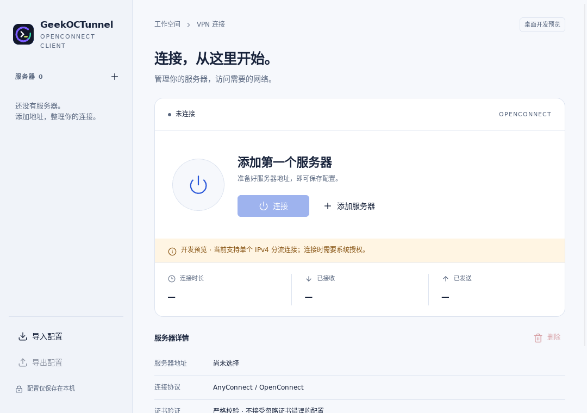

# GeekOCTunnel Desktop

A desktop OpenConnect client for ocserv and AnyConnect-compatible gateways. The
Tauri 2 interface manages server profiles, authentication and connection status.
A shared C++ core handles the VPN protocol; a separately authorized helper
configures the operating system's temporary tunnel interface.

**Desktop preview: IPv4 split tunnels, up to eight independent servers.** Download the
[Windows/Linux release](https://github.com/def-Richard/GeekOCTunnel/releases/tag/desktop-v0.1.0-preview.1).
See the [Windows validation report](../doc/DESKTOP_WINDOWS_DIAGNOSTICS.md) for measured
results and the [roadmap](../doc/NEXT_CROSS_PLATFORM_PLAN.md) for later work.

## Features

- Add, edit, import and export profiles. Atomic saves and revision checks prevent
  partial writes and silent overwriting of another window's changes.
  An active session locks only its own profile; other profiles remain editable
  and new profiles can be added. Bulk import stays unavailable while sessions run.
- Username/password and supported selection forms. Unsupported authentication
  types are rejected; credentials and cookies never enter exported profiles.
- Certificate review showing the endpoint and fingerprint. An exception applies
  only to that challenge; importing a profile cannot disable TLS validation.
- Per-server connection state, assigned IP, gateway, MTU, routes, DNS and actual traffic counters.
- Bounded in-memory logs for authentication, certificates, network setup and reconnects;
  raw protocol messages, passwords and cookies are never copied into the log.
- Automatic backoff after transient network failures or server restarts. Authentication
  refusal, certificate problems, route conflicts and manual disconnect stop retrying.
- Independent connections to up to eight profiles. Overlapping routes are refused;
  disconnecting one tunnel preserves the others.
- Closing offers tray mode or disconnect-and-exit, with an optional saved preference.
  Tray mode keeps tunnels running and pauses UI polling. Exit waits for cleanup.
- The tray distinguishes idle, connected, connecting/reconnecting, partial success,
  and failure. A number badge counts established tunnels (2–8). Windows hover text
  names connected/pending servers; the menu shows the longer status list on both
  platforms. It contains profile names, not endpoints or login details. Updates
  come from native events and continue while the WebView is released, without polling.
- Only one application instance runs per user. Launching again restores the existing
  window, including after lightweight mode has released its WebView. Exit older
  previews before upgrading; they do not implement the activation protocol.
- Global settings control close/minimize behavior, automatic reconnect, and an optional
  lightweight mode that destroys the hidden WebView after 5–3600 seconds. Reopening
  recreates the window and restores bounded diagnostics from the Rust backend.
- Each profile can enable UDP/DTLS; connection details show the actual active data
  transport and fall back to TLS/TCP if DTLS is unavailable. Existing profiles stay TCP.
- Certificate verification is on by default. An explicit global bypass is available
  for new sessions, visibly marked in settings and in the affected connection.
- Optional Windows Credential Manager or Linux Secret Service storage. An unavailable
  keyring causes an explicit “not saved” result, never a plaintext fallback.
  Remembered login includes the successful authentication Group. Older saved entries
  need one new login with Remember enabled to add the previously omitted Group.

## Platforms

| Platform | Requirements | Network implementation |
| --- | --- | --- |
| Windows x64 | Windows 10 1903+ / 11, WebView2, MSVC runtime, administrator consent | Signed Wintun DLL, private named pipes, Windows IP/DNS APIs |
| Ubuntu 24.04 / Debian 12 x64 | Qt 6, GTK 3, WebKitGTK 4.1, Chinese fonts, accessibility service, Polkit agent, iproute2, active systemd-resolved | Nonpersistent TUN, peer-checked Unix socket, Polkit helper, per-link resolved settings |
| macOS | Planned | Not built or validated |

Run the GUI and core as an ordinary user. Linux installation must be root-owned;
the helper rejects writable installation paths and verifies the calling process
and UID before accepting its fixed network plan. There is no permanent project daemon.

## Current limits

Only IPv4 split routes are supported. Default routes, IPv6, split-exclusion rules
and overlap with existing non-default routes are refused. Browser SSO and client
certificates are not supported. Network handover is not yet validated. DNS is
configured per interface; conflicting DNS namespaces are not translated or routed
by domain. Each reconnect reauthorizes its helper and may prompt for UAC/Polkit.

Windows single-instance activation and WebView release have been exercised with real
windows. Debian and Ubuntu passed 15 isolated VPN scenarios; settings and tray behavior
were exercised under Xvfb. See the [parity report](../doc/DESKTOP_PARITY_RESULTS.md).
Linux tray features require a StatusNotifier/AppIndicator host. Without one, tray and
lightweight controls are disabled and ordinary taskbar minimization remains available.
Linux's tray backend does not support custom hover text; open its menu for the same
connection summary. Desktop-shell icon sizing and colors may vary.

Linux DNS requires systemd-resolved integration. The application configures only
its own link and does not rewrite `/etc/resolv.conf`. Systems using another DNS
manager require additional integration before they can be treated as supported.

Removing a profile does not currently erase an existing system keyring entry.
Remove retired entries through Windows Credential Manager or your Linux keyring manager.

## Build and run

See the [build guide](frontend/README.md). The default build includes the configuration
bridge, session core, platform helper and tests. The original Qt Widgets window is
retained only as an optional reference (`BUILD_LEGACY_WIDGETS`).

Build desktop OpenConnect separately from Android's checkout, using the revision in
`native/source-lock.json`. Apply
[`openconnect-nonblocking-tls.patch`](dependencies/openconnect-nonblocking-tls.patch)
on both platforms and
[`openconnect-windows-message-pipe.patch`](dependencies/openconnect-windows-message-pipe.patch)
on Windows. The Windows patch carries raw IP packets between the ordinary core and
the Wintun helper; the helper never receives login credentials.

Windows distributes one `GeekOCTunnel.exe`. It embeds the native runtime and extracts
verified files into a versioned per-user application cache. The configuration bridge
runs briefly on demand; each connected VPN uses its own ordinary-user Core and
privileged Helper. These processes exit after disconnect; there is no idle helper.
The separate privilege boundary is intentional, even though distribution is one file.
Windows resolves physical executable paths before UAC launch and process identity
checks, including when a user's application-data directory is redirected.
Linux bundles contain
`geekoctunnel`, `native/`, `app-icon.svg`, the supplied Polkit `.policy` file and `Install-Linux.sh`; install with
`sudo bash Install-Linux.sh /path/to/bundle`, then launch normally. Do not run the GUI
as root or administrator.

## Privacy and architecture

The bundled UI loads no remote assets or telemetry. Profiles use Qt's per-user
`GeekOCTunnel/GeekOCTunnel-Desktop-Preview` configuration directory. Names and server
addresses can be private; export explains its contents before sharing. Schema v1
rejects unknown fields and credentials rather than silently discarding them.

The configuration bridge uses bounded request/response pipes. VPN sessions use a
separate bounded stream with session, generation, sequence and challenge identifiers.
The UI cannot choose arbitrary executables, shell commands, driver paths or privileged
scripts. Helpers receive only a validated binary plan and stop signal.

Helpers own only their newly created interface. Disconnect, failed setup and parent
death trigger cleanup. If cleanup cannot be confirmed, the UI reports it and blocks
another connection instead of claiming normal disconnection.

## Licensing and release status

Tauri is MIT/Apache-2.0; Lucide is ISC. Qt, OpenConnect and Wintun retain their own
licensing obligations; see [third-party notices](../THIRD_PARTY_NOTICES.md).
Release archives include notices and checksums; matching third-party sources are
attached to the same release. These are unsigned preview bundles. Upgrade/uninstall,
Wayland and long-duration roaming acceptance remain limited as documented.
